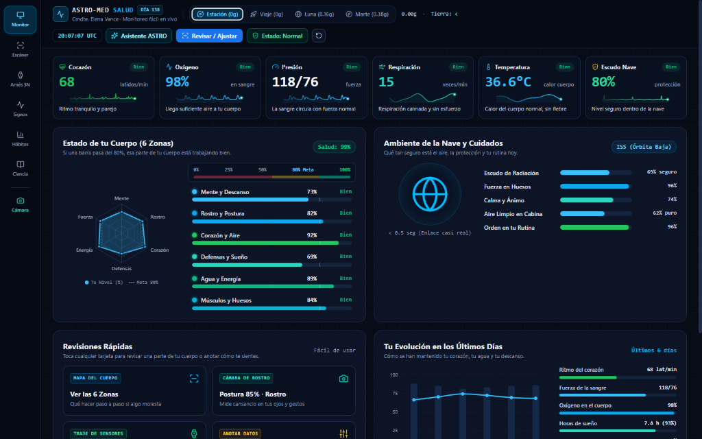
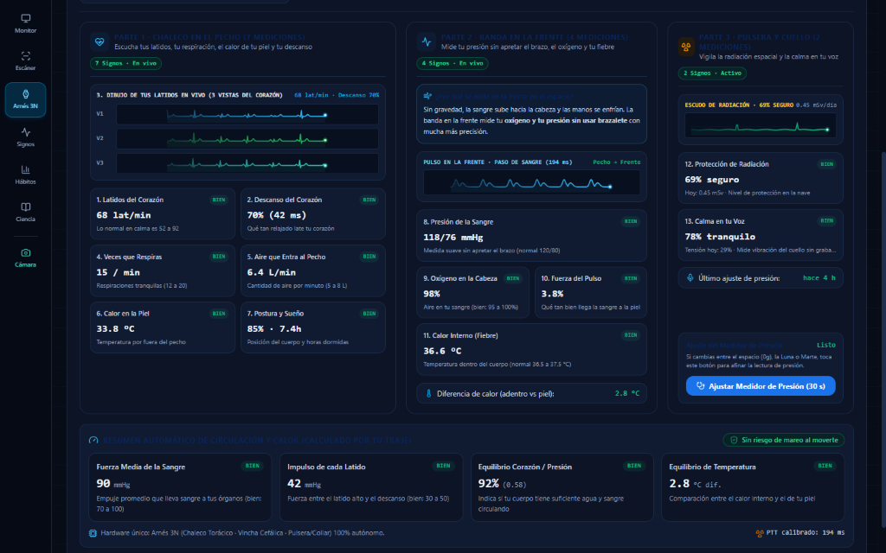
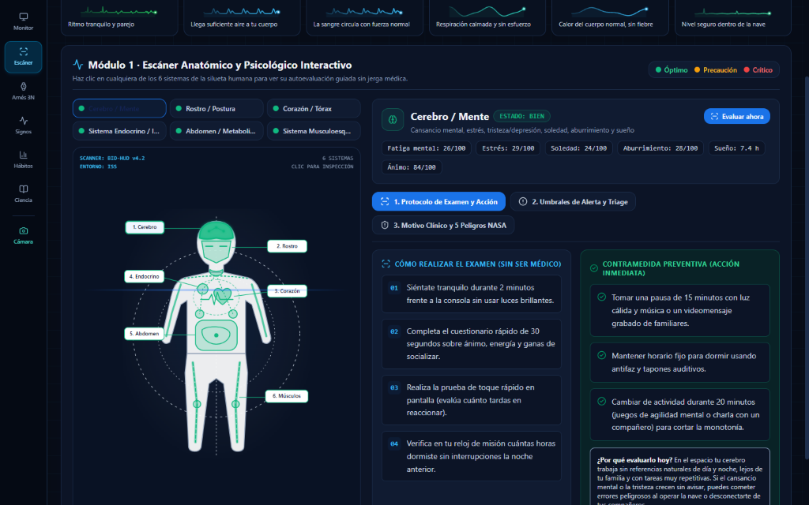
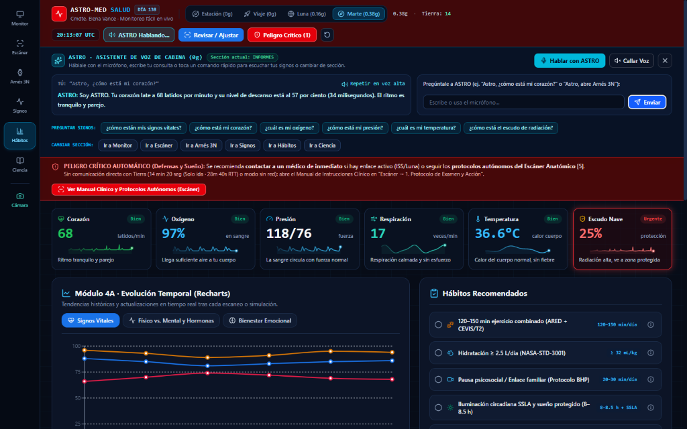

# ASTRO-MED — Autonomous Spaceflight Health Monitoring System

> **NASA Space Apps Challenge 2026**
> **Challenge:** *Create Health Monitoring Software for Astronauts on Space Missions*

**ASTRO-MED** is an offline-first aerospace biomedical telemetry and self-assessment web console built for astronauts operating in **Low Earth Orbit (ISS)**, **Deep-Space Transit (Orion)**, **Artemis Lunar Habitats**, and **Mars Surface Rovers**.

Designed for crew members without clinical medical training, ASTRO-MED brings together simulated wearable vitals, behavioral health indicators, radiation dosimetry, routine deviation tracking, preventive countermeasures, and autonomous emergency checklists—all running **100% locally in the browser** without requiring live connectivity to Earth.

> **Language Note:** The interactive console UI (`src/app/layout.tsx`, `src/components/`) is currently localized in **Spanish (`es`)** as built during the local hackathon sprint. This `README.md` provides complete technical and scientific documentation in English for global evaluation.

---

## Table of Contents

- [Problem & Mission Context](#problem--mission-context)
- [Core Capabilities](#core-capabilities)
- [NASA & CSA Guidelines, Data References & Simulation Disclaimer](#nasa--csa-guidelines-data-references--simulation-disclaimer)
- [Tech Stack](#tech-stack)
- [Architecture & Repository Structure](#architecture--repository-structure)
- [Screenshots](#screenshots)
- [Running Locally](#running-locally)
- [Static Export & Firebase Hosting Deployment](#static-export--firebase-hosting-deployment)
- [License](#license)

---

## Problem & Mission Context

As human exploration moves beyond Low Earth Orbit toward the Moon and Mars, crew health monitoring faces critical constraints:

1. **Communication Latency & Blackouts:** Deep-space transit and Mars surface operations introduce one-way signal delays exceeding **14 minutes** (~28+ min round-trip), making real-time Earth flight-surgeon consultations impossible during acute events.
2. **Spaceflight Physiological & Psychological Hazards:** Long-duration crews face elevated ionizing radiation, microgravity/partial-gravity fluid shifts and bone/muscle loss, disrupted circadian cycles (16 orbital sunrises per 24 h on the ISS or 24h39m Martian sols), isolation, and monotonous closed habitats.
3. **Non-Physician Operability:** On-board software must translate raw physiological signals into clear, jargon-free diagnostic workflows, actionable countermeasures, and guided stabilization steps.

**ASTRO-MED** addresses these constraints with an autonomous clinical console that adapts risk evaluation to the active mission environment, stores telemetry locally (`localStorage`), integrates an interactive hands-free voice assistant (**Asistente ASTRO**) for `0g` operations, and provides step-by-step autonomous guidance when Earth contact is delayed or offline.

---

## Core Capabilities

- **4 Mission Environment Profiles (`src/data/missionData.ts`)**:
  Switch dynamically between **ISS (`0.00g`, `0.45 mSv/day`, `< 0.5 s` link)**, **Deep-Space Transit (`0.00g`, `1.25 mSv/day`, `110 s` one-way)**, **Artemis Lunar Base (`0.16g`, `0.95 mSv/day`, `2.6 s` RTT)**, and **Mars Rover (`0.38g`, `1.65 mSv/day`, `14m 20s` one-way)**. Gravity load factors, isolation bonuses, cabin pressure/$\text{CO}_2$ telemetry, and environment alerts recalculate automatically.
- **Real-Time Physiological Waveform Strip (`PrimaryVitalsStrip.tsx`, `LivePhysioWaveform.tsx`)**:
  Renders 6 primary live cards (**Heart Rate**, **$\text{SpO}_2$**, **Blood Pressure**, **Respiration**, **Body Temperature**, and **Radiation Shield**) with smooth 60 FPS waveforms calibrated to 1:1 human real-time physiology for **ECG**, **PPG**, **ABP**, **Respiration (RESP)**, **Thermal/Metabolic Waves (METAB)**, and **Cosmic Radiation Scintillation Hits (RAD)**.
- **Arnés 3N Bio-Monitor CSA (`WearableHarnessPanel.tsx`)**:
  Models a modular **7 + 4 + 2 = 13 continuous signs** wearable architecture across **1. Chest Vest (7 measurements)**, **2. Forehead Band (4 measurements)**, and **3. Wrist & Collar Sensor (2 measurements)**—tracking HR, HRV RMSSD, 3-lead textile ECG, Respiratory Rate, Minute Ventilation, Pulse Transit Time, cuffless BP with 30 s oscillometric calibration prompts, Perfusion Index, Core/Skin Temperature, Posture & Sleep, Radiation, and Vocal/Acoustic Stress—plus automatic hemodynamic safety calculations (**MAP**, **Pulse Pressure**, **Shock Index**, **Thermal Differential**, and **orthostatic alerts**).
- **6-Zone Anatomical & Psychological Scanner (`AnatomicalScanner.tsx`)**:
  Provides plain-language self-examination guides, monitored variables, threshold criteria (`optimal` / `warning` / `critical`), and preventive countermeasures across 6 zones:
  - Brain & Mental Health (`cerebro`)
  - Face, Posture & Ocular Tension (`rostro`)
  - Heart & Respiration (`corazon`)
  - Endocrine & Radiation (`endocrino`)
  - Abdomen, Hydration & Metabolism (`abdomen`)
  - Musculoskeletal (`musculo`)
- **Behavioral Health & Routine Deviation Detector (`BiomarkersDashboard.tsx`, `healthEngine.ts`)**:
  Tracks mental fatigue, reaction time (ms), stress, depression risk, loneliness, boredom, sleep duration, and deviations against baseline sleep schedule, exercise minutes, meals, and hydration liters.
- **Multimodal Capture Modal (`MultimodalScanModal.tsx`)**:
  Supports live browser webcam capture or simulated facial/posture evaluation scenarios alongside manual biomarker and routine input, logging entries to the offline Mission Assessment Log.
- **Trend Charts & NASA HRP Preventive Habits (`TelemetryCharts.tsx`, `RecommendedHabitsPanel.tsx`, `HabitsExplanationPanel.tsx`)**:
  Interactive `Recharts` visualizations (biometric radar, physiological/workload/emotional trend series) paired with actionable daily preventive habits and custom crew habit creation.
- **Automatic Risk Detection & Autonomous Guidance (`TopMissionBar.tsx`, `EmergencyBannerModal.tsx`)**:
  Continuously evaluates physiological and environmental zones to display automatic **Normal**, **Warning (`Precaución`)**, or **Critical (`Peligro Crítico`)** status indicators in the top command bar, guiding crew members to consult Earth when low-latency links are available or follow autonomous clinical & 5-step emergency stabilization protocols when offline/delayed.
- **Interactive ASTRO Voice Assistant (`TopMissionBar.tsx`)**:
  Uses the browser Web Speech API (`SpeechRecognition` and `speechSynthesis`) plus quick-command chips and text input so crew members can ask ASTRO about live vitals or switch console sections and gravity environments hands-free in `0g`.

---

## NASA & CSA Guidelines, Data References & Simulation Disclaimer

ASTRO-MED structures its clinical scoring rules, diagnostic guides, and preventive habit recommendations around publicly documented space medicine frameworks:

- **NASA Human Research Program (HRP) — 5 Hazards of Human Spaceflight:**
  - *Space Radiation*
  - *Isolation and Confinement*
  - *Distance from Earth*
  - *Altered Gravity Fields*
  - *Hostile/Closed Environments*
- **NASA Standards & Countermeasures Referenced:**
  - **NASA-STD-3001** hydration (`≥ 32 mL/kg/day`, ~`2.1–2.5 L` base) and protected sleep window (`8–8.5 h`) guidelines
  - **ARED + CEVIS/T2** daily resistive and aerobic exercise protocols (`120–150 min/day`)
  - **NASA Behavioral Health & Performance (BHP)** family/psychosocial support and Private Psychological Conference (PPC) routines
  - **ISS Solid State Lighting Assemblies (SSLA)** circadian lighting schedules and **Space Nutrition** Vitamin D (`800 UI/day`) protocols
- **Canadian Space Agency (CSA / ASC) Dosimetry, Bio-Monitor & References:**
  - Radiation thresholds inspired by **Radi-N2** and **EVARM** dosimeters (`0.65 mSv/day` nominal, `1.45 mSv/day` daily alert, `200 mSv/year`, `600 mSv` career limit)
  - Wearable and autonomous health monitoring concepts aligned with **CSA Bio-Monitor / Bio-Analyzer** and **16 verified NASA/CSA citations** embedded in the console (`standards.nasa.gov`, `asc-csa.gc.ca`, `osdr.nasa.gov`, `humanresearchroadmap.nasa.gov`, `ntrs.nasa.gov`)

> **Disclaimer & Branding Compliance:**
> - **Simulated Data:** All physiological waveforms, baseline biometrics, camera simulations, and mission environment scenarios in ASTRO-MED are **simulated software models and educational references** derived from open NASA/CSA spaceflight literature. They do **not** connect to certified medical hardware or live NASA flight telemetry and must not be used for real clinical diagnosis.
> - **No NASA Logo:** In accordance with NASA media guidelines and NASA Space Apps Challenge rules, this repository and application do **not** use the official NASA insignia or logo. All UI icons are provided by `lucide-react`.

---

## Tech Stack

| Layer | Technology | Details (from repository) |
| --- | --- | --- |
| **Framework** | Next.js `^16.4.6` | App Router configured for static export (`output: "export"`) |
| **UI Library** | React `^19.3.1` | Client-side interactive telemetry console (`"use client"`) |
| **Language** | TypeScript `^5.8.2` | Strict type checking (`"strict": true` in `tsconfig.json`) |
| **Styling** | Tailwind CSS `^4.3.5` | `@tailwindcss/postcss` + custom dark aerospace HUD overrides (`src/app/globals.css`) |
| **Data Visualization** | Recharts `^3.10.1` | Hexagonal biometric radar, composed charts, area/line trend graphs |
| **Icons** | Lucide React `^1.73.0` | Aerospace, clinical, and status iconography |
| **State & Persistence** | Browser `localStorage` + `useSyncExternalStore` | Offline persistence (`astro-med-hrp-state-v1`) |
| **Browser APIs** | Web Speech API & `MediaDevices` | Optional `0g` voice briefing and webcam assessment mode |
| **Runtime Target** | Node.js `v22.23.1` | Specified in `.nvmrc` |
| **Hosting** | Firebase Hosting | Static asset deployment from `out/` (`firebase.json`, `.firebaserc`) |

---

## Architecture & Repository Structure

```text
astro-health-monitor/
├── .firebaserc                              # Firebase project alias (default: "astro-health-monitor")
├── .nvmrc                                   # Node.js version pin (v22.23.1)
├── eslint.config.mjs                        # ESLint configuration (eslint-config-next)
├── firebase.json                            # Firebase Hosting config (public: "out", cleanUrls: true)
├── next.config.ts                           # Next.js config (output: "export", images.unoptimized: true)
├── package.json                             # Scripts & dependencies (nasa-astrocare-monitor)
├── tsconfig.json                            # TypeScript compiler configuration
├── LICENSE                                  # MIT License (2026 ASTRO-MED Team)
├── README.md                                # Project documentation
├── docs/                                    # UI screenshots referenced in README
└── src/
    ├── app/
    │   ├── globals.css                      # Tailwind v4 imports, dark HUD grid & animations
    │   ├── layout.tsx                       # Root HTML shell & metadata
    │   └── page.tsx                         # Main stateful dashboard & offline storage sync
    ├── types/
    │   └── astronaut.ts                     # Domain interfaces (biomarkers, environments, zones, quests)
    ├── data/
    │   └── missionData.ts                   # Mission profiles, diagnostic guides, CSA limits, HRP habits
    ├── utils/
    │   └── healthEngine.ts                  # Zone evaluation, readiness scoring, hemodynamics & SOS engine
    └── components/
        ├── TopMissionBar.tsx                # Environment switcher, UTC clock, ASTRO voice assistant, auto risk status
        ├── LeftNavSidebar.tsx               # Primary 6-section rail & mobile navigation bar
        ├── SectionPagerControls.tsx         # Sequential module navigation controls
        ├── MissionTimeSyncBar.tsx           # Mission timeline synchronization bar
        ├── PrimaryVitalsStrip.tsx           # Top 6 real-time vital readout cards (incl. Temp & Rad) with waveforms
        ├── LivePhysioWaveform.tsx           # 60 FPS real-time physiological signal renderer
        ├── OverviewBentoGrid.tsx            # General overview, 6-zone biometric radar & environment alerts
        ├── AnatomicalScanner.tsx            # 6-system interactive diagnostic & self-exam guide
        ├── WearableHarnessPanel.tsx         # Arnés 3N (7+4+2 = 13 continuous signs) & cuff calibration
        ├── BiomarkersDashboard.tsx          # Physical vitals, BHP mental indices & routine deviation detector
        ├── TelemetryCharts.tsx              # Historical physiological, load & emotional Recharts views
        ├── RecommendedHabitsPanel.tsx       # Interactive NASA HRP countermeasures checklist & custom habits
        ├── HabitsExplanationPanel.tsx       # Scientific rationale cards per preventive habit
        ├── habitCategoryMeta.tsx            # Category icons and labels for preventive habits
        ├── MultimodalScanModal.tsx          # Camera/simulation scanner & manual telemetry entry modal
        ├── EmergencyBannerModal.tsx         # Critical alert banner & 5-step autonomous stabilization checklist
        ├── ScientificFrameworkSection.tsx   # Dedicated NASA HRP & CSA scientific reference view
        ├── ScientificReferencesContent.tsx  # CSA Radi-N2 limits, 5 hazards & 16 verified NASA/CSA citations
        └── ScientificReferencesModal.tsx    # Modal wrapper for scientific references
```

### Data & Evaluation Flow

1. **State Source (`src/app/page.tsx`)**: Reads and persists `AstronautDashboardState` in `localStorage` via `useSyncExternalStore` so the application boots immediately offline with deterministic hydration.
2. **Environment & Simulation Engine (`src/data/missionData.ts` & `src/utils/healthEngine.ts`)**: Changing environments (`iss`, `nave`, `luna`, `marte`), applying camera/manual inputs, or toggling emergency mode triggers pure evaluation functions (`evaluateAllZoneStatuses`, `computeHemodynamicIndices`, `computeRoutineDeviations`, `computeMissionReadiness`) to compute per-zone statuses and the global readiness score (`0–100%`).
3. **Presentation Layer (`src/components/*`)**: Six modular sections render the consolidated HUD without blocking server dependencies, allowing full static export (`next build` -> `out/`).

---

## Screenshots

### General Mission Dashboard & Biometric Radar


### 3-Node Wearable Bio-Monitor Harness & Live Waveforms


### 6-Zone Anatomical & Behavioral Scanner


### Interactive ASTRO Voice Assistant, Mars Alert & NASA HRP Habits


---

## Running Locally

### Prerequisites

- **Node.js** `v22.23.1` (see `.nvmrc`; Node.js `v20+` / `v22+` recommended)
- **npm** (bundled with Node.js)

### Step-by-Step Setup

1. **Clone the repository:**

   ```bash
   git clone https://github.com/oluvalero-ui/astro-health-monitor.git
   cd astro-health-monitor
   ```

2. **Install dependencies:**

   ```bash
   npm install
   ```

3. **Start the local development server:**

   ```bash
   npm run dev
   ```

   Open `http://localhost:3000` in your browser.

4. **Run static checks and production build:**

   ```bash
   npm run lint
   npm run build
   ```

   Because `next.config.ts` sets `output: "export"`, `npm run build` compiles and exports the static site directly into the `out/` directory.

---

## Static Export & Firebase Hosting Deployment

The repository is pre-configured for static hosting on **Firebase Hosting**:

- **`next.config.ts`**: Sets `output: "export"` and `images: { unoptimized: true }`, generating static HTML/JS/CSS assets in `out/`.
- **`firebase.json`**: Serves `"public": "out"` with `"cleanUrls": true`.
- **`.firebaserc`**: Maps the default project to `astro-health-monitor`.

### Build & Deploy Commands

```bash
# 1. Build the static export into ./out
npm run build

# 2. Authenticate with Firebase CLI (first time only; install globally if needed: npm install -g firebase-tools)
firebase login

# 3. Deploy to Firebase Hosting
firebase deploy --only hosting
```

After deployment finishes, Firebase CLI prints the live **Hosting URL** (typically `https://astro-health-monitor.web.app` / `https://astro-health-monitor.firebaseapp.com`).

---

## License

This project is released under the **MIT License** — see the [LICENSE](./LICENSE) file for details.
